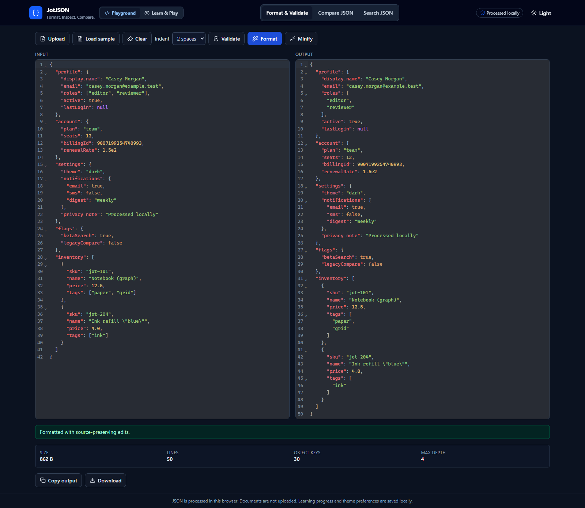
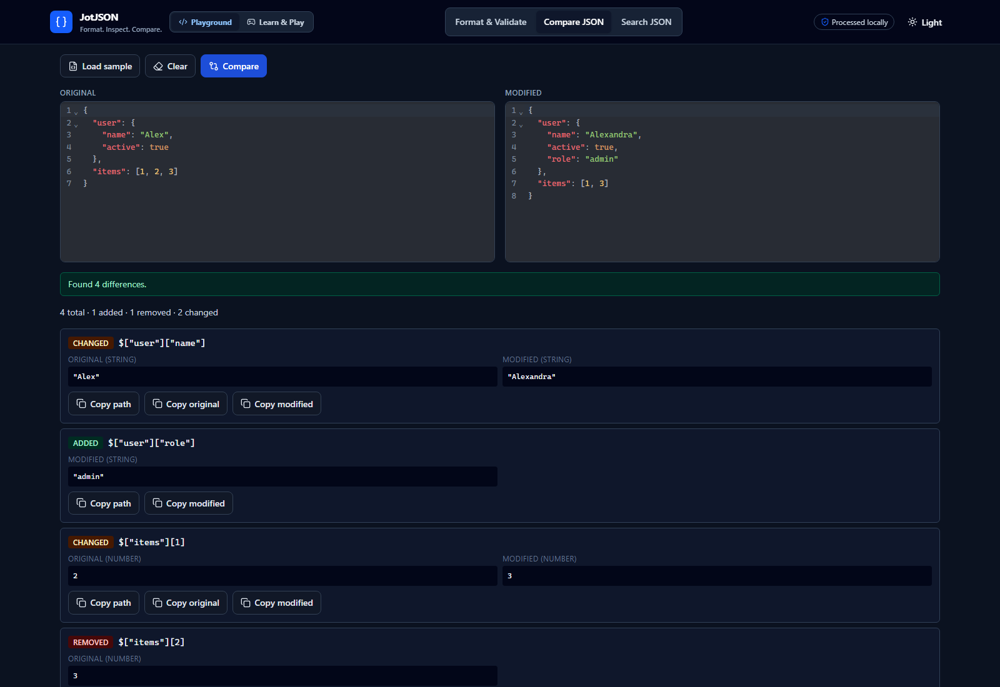
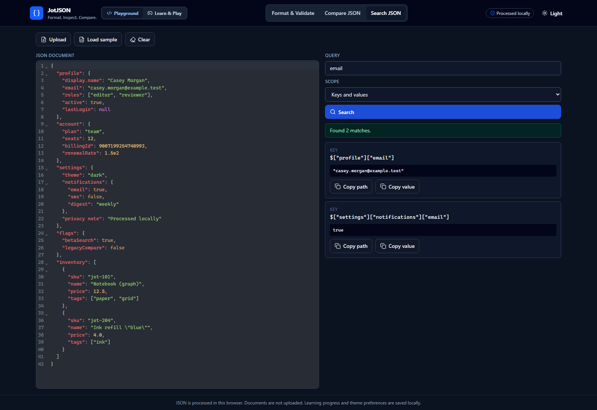
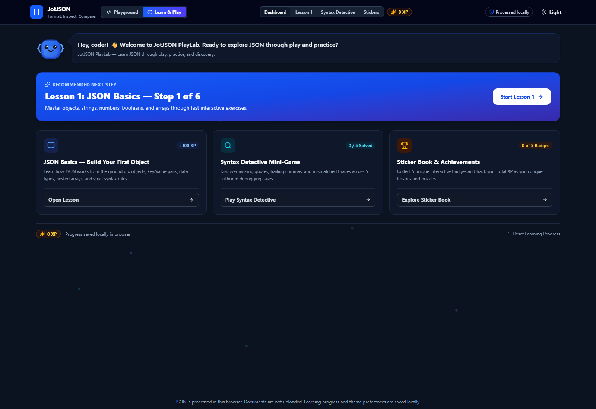
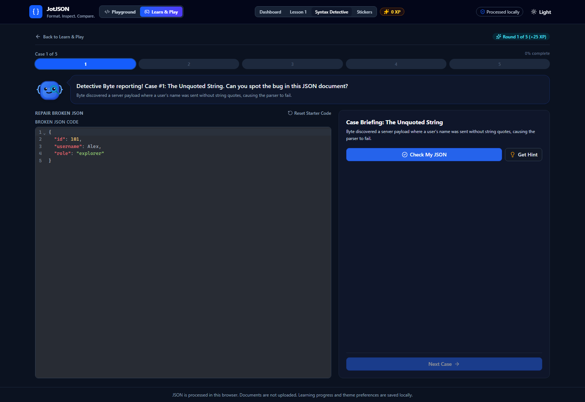
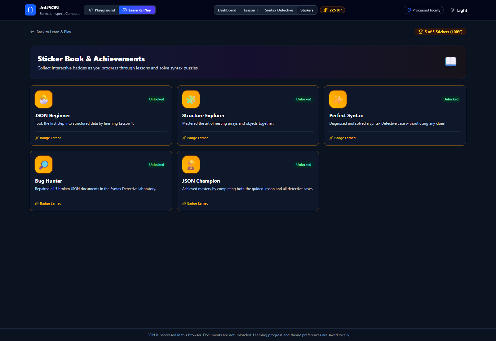

# JotJSON

> **Learn JSON through play, practice, and discovery. Plus professional developer formatting, inspection, and comparison.**  
> Version: 2.0.0  
> License: MIT  
> Live App: [https://hafiz-hamza-liaqat.github.io/JotJSON/](https://hafiz-hamza-liaqat.github.io/JotJSON/)

JotJSON is a fast, local-first web application featuring two dedicated experiences:
1. **Playground:** A zero-backend, zero-telemetry developer toolkit for strictly validating, formatting, diffing, and searching JSON documents entirely in the browser.
2. **Learn & Play (JotJSON PlayLab):** An interactive, gamified learning laboratory designed for students and beginners, featuring Byte the Mascot, guided lessons, syntax debugging puzzles, collectible achievement stickers, and an idempotent XP progression system.

All processing, parsing, and operations execute in client memory with zero server telemetry. Sensitive payloads and documents never leave your machine.

---

## Screenshots

| Format & Validate | Compare JSON |
| :---: | :---: |
| [](docs/screenshots/01-format-validate.png)<br><sub>**Format & Validate** — Strict JSON validation, line/column diagnostics, indentation options, token-preserving minification, and UTF-8 document statistics.</sub> | [](docs/screenshots/02-compare-json.png)<br><sub>**Compare JSON** — Preloaded dual-editor structural comparison highlighting added, removed, and changed values with exact JSONPath locations.</sub> |
| **Search JSON** | **Learn & Play Dashboard** |
| [](docs/screenshots/03-search-json.png)<br><sub>**Search JSON** — Deep nested traversal searching across object keys and primitive values with instant match navigation.</sub> | [](docs/screenshots/04-learn-play.png)<br><sub>**JotJSON PlayLab** — Interactive learning dashboard featuring Byte the Mascot, guided lesson roadmap, and XP progression.</sub> |
| **Syntax Detective** | **Sticker Book & Achievements** |
| [](docs/screenshots/05-syntax-detective.png)<br><sub>**Syntax Detective** — Hands-on JSON repair puzzles with real-time syntax checking, multi-tier hints, and reward celebrations.</sub> | [](docs/screenshots/06-sticker-book.png)<br><sub>**Sticker Book** — Collectible achievement stickers and idempotent XP tracking celebrating curriculum milestones.</sub> |

---

## Experiences Overview

### Mode 1: Playground (Developer Utilities)

#### Workspace A: Format & Validate
- **Strict JSON Validation:** Validates standard RFC 8259 JSON, rejecting trailing commas, comments, and unquoted/single-quoted keys. Root primitives (`true`, `false`, `null`, numbers, strings) are supported.
- **Diagnostics with Exact Positions:** Reports 1-based line and column diagnostics along with character offsets for precise troubleshooting.
- **Visual Error Highlighting:** Highlighting directly in the CodeMirror 6 editor gutter and error lines, automatically scrolling to the error location.
- **Source-Preserving Formatting:** Indentation options include 2 spaces, 4 spaces, or tabs. Preserves string contents, escaped characters, exponent notation, and object key order.
- **Token-Aware Minification:** Strips insignificant whitespace between tokens without modifying whitespace within strings or altering exact numeric representations.
- **Live UTF-8 Document Statistics:** Computes true UTF-8 byte length (not UTF-16 code units), line count, total nested object key count, and maximum nesting depth.
- **Stale State Management:** When input is edited after an operation, output and statistics are flagged as stale until re-run.

#### Workspace B: Compare JSON
- **Structural Diff Engine:** Compares two independently editable JSON documents structurally, ignoring object-key order and formatting whitespace differences.
- **Difference Categories:** Highlights added properties, removed properties, and changed values with clear badges.
- **Arbitrary Numeric Precision:** Handles arbitrarily large numbers (beyond JavaScript's `Number.MAX_SAFE_INTEGER`, such as `9007199254740993`) without float precision loss. Normalizes decimal equivalents (e.g. `1`, `1.0`, `1e0`) without destructive type coercion.
- **Unambiguous JSONPath Locations:** Generates safe JSONPath strings (e.g. `$["profile"]["display.name"]`, `$["items"][0]`) escaping dots, quotes, and special characters.
- **Copy Utilities:** One-click copy for difference paths, original values, and modified values.

#### Workspace C: Search JSON
- **Deep Nested Search:** Traverses arbitrary structures to search object keys, string values, numeric tokens, booleans, and nulls.
- **Flexible Scope:** Search keys only, primitive values only, or both simultaneously.
- **Partial & Case-Insensitive Matching:** Matches sub-strings efficiently without requiring explicit quote characters for strings.
- **Display Limit & Safety:** Caps displayed UI items at 100 matches while reporting the true total match count, preventing DOM rendering freezes on huge payloads.

---

### Mode 2: Learn & Play (JotJSON PlayLab)

#### Byte the Mascot
- Pure inline SVG and CSS animated mascot with 5 distinct emotional states: `idle`, `happy`, `thinking`, `detective`, and `champion`.
- Contextual speech bubble offering friendly encouragements, gentle guidance, and clear explanations.
- Respects `prefers-reduced-motion` to keep animations comfortable and accessible.

#### Guided Lesson 1: JSON Basics — Build Your First Object
- Step-by-step curriculum with 6 interactive steps:
  1. **What is JSON?** — Origin, purpose, and universal network exchange format.
  2. **Objects & Key/Value Pairs** — Curly braces `{ }`, colon separators, and naming conventions.
  3. **Strings vs Numbers** — Why quotation marks define strings and distinguish `"25"` from `25`.
  4. **Booleans and Null** — Reserved lowercase keywords `true`, `false`, and `null`.
  5. **Arrays & Nested Data** — Square brackets `[ ]` and complex hierarchical object trees.
  6. **Strict Syntax Rules** — Mastering RFC 8259 restrictions (no single quotes, no trailing commas).
- Immediate interactive feedback, multi-tier hints, and reward animations upon completion (+100 XP).

#### Syntax Detective Mini-Game
- 5 authored real-world JSON debugging cases:
  1. *The Unquoted String* — Fixing unquoted text in property values.
  2. *The Trailing Comma Trap* — Catching trailing commas after the final property.
  3. *The Disconnected Properties* — Resolving missing property separator commas.
  4. *The Bracket Mystery* — Fixing mismatched array brackets and object braces.
  5. *The Single Quote Intruder* — Converting illegal JavaScript single quotes into strict double quotes.
- Live CodeMirror 6 editor with error line markers.
- Intelligent evaluation: validates syntax errors, performs structural comparison against expected solutions, and verifies objective completion.
- Multi-tier clue system with progressive hints.
- Case solved celebration bursts and progression tracking (+25 XP per solved case).

#### Sticker Book & Achievements
- 5 unique collectible badges:
  - 🐣 **JSON Beginner:** Complete Lesson 1 ("JSON Basics").
  - 🔎 **Bug Hunter:** Solve all 5 Syntax Detective cases.
  - 🧩 **Structure Explorer:** Complete the Arrays & Nested Data lesson step in Lesson 1.
  - ✨ **Perfect Syntax:** Solve a detective case on the very first try without hints.
  - 🏆 **JSON Champion:** Complete Lesson 1 and solve all 5 detective cases.
- Celebratory unlock modal with confetti burst.
- Grid gallery displaying unlocked vs locked states with clear unlock requirements.

#### Progress & Privacy Architecture
- **Offline Local Persistence:** State stored under versioned key `jotjson-learning-progress:v2` in `localStorage`.
- **Zero Content Persistence:** User-entered JSON documents are NEVER written to storage or transmitted.
- **Graceful Corruption Recovery:** Schema-validated state recovery that resets gracefully to defaults if storage is modified or corrupt.
- **Idempotent Rewards:** Completing a case or lesson multiple times never duplicates XP rewards.
- **Complete Reset Option:** Confirmation-protected progress reset allows restarting the curriculum cleanly.

---

## Technology Stack

- **Framework:** React 19 + TypeScript (strict mode enabled)
- **Bundler & Build Tool:** Vite 8
- **Styling:** Tailwind CSS 4 with custom dark/light mode variants and responsive design tokens
- **Code Editor:** CodeMirror 6 via `@uiw/react-codemirror` and `@codemirror/lang-json`
- **JSON Parsing & AST:** `jsonc-parser` (configured strictly with `disallowComments: true` and `allowTrailingComma: false`)
- **Icons:** Lucide React
- **Unit & Component Tests:** Vitest 5 + React Testing Library + `@testing-library/jest-dom` + `jsdom` (113 tests across 15 suites)
- **End-to-End Tests:** Playwright 1.64 across Desktop & Mobile viewports (25 tests)
- **Linters:** Oxlint + ESLint 10

---

## Installation & Setup

### Prerequisites
- **Node.js:** LTS version 20.x or 22.x recommended (tested on Node.js 22).
- **npm:** version 10.x or later.

### Install dependencies
```bash
npm install
```

---

## Available Scripts

| Command | Purpose |
| :--- | :--- |
| `npm run dev` | Starts Vite development server at `http://localhost:5173` |
| `npm run build` | Runs TypeScript project build (`tsc -b`) and bundles for production with Vite |
| `npm run preview` | Previews the production build locally |
| `npm run lint` | Runs Oxlint and ESLint across the codebase |
| `npm run typecheck` | Validates TypeScript types across source files and tests without emitting files |
| `npm test` | Starts Vitest in interactive watch mode |
| `npm run test:run` | Runs all Vitest unit and component tests once (113 tests across 15 suites) |
| `npm run test:e2e` | Runs Playwright browser end-to-end test suite (25 tests) |
| `npm run check` | Runs lint, typecheck, and unit/component tests in sequence |
| `npm run verify:build` | Verifies production HTML asset paths match `/JotJSON/assets/` and exist in `dist` |
| `npm run capture:screenshots` | Captures the six reproducible desktop screenshots to `docs/screenshots/` |

---

## Deployment Instructions

### GitHub Pages

JotJSON includes ready-to-use GitHub Actions workflows under `.github/workflows/`:
- **`ci.yml`**: Runs linting, type checks, unit tests, and production build on pull requests and pushes to `main`.
- **`pages.yml`**: Automatically builds with `BASE_PATH: /JotJSON/`, verifies asset paths with `scripts/verify-build.mjs`, and deploys to GitHub Pages on pushes to `main`.

#### Enabling GitHub Pages:
1. In your GitHub repository, navigate to **Settings** > **Pages**.
2. Under **Build and deployment** > **Source**, choose **GitHub Actions**.
3. Pushes to `main` will trigger build, verification, and deployment to `https://hafiz-hamza-liaqat.github.io/JotJSON/`.
4. **Case-Sensitive Base Path:** The repository name `JotJSON` requires asset links to match `/JotJSON/assets/...`. `pages.yml` and `scripts/verify-build.mjs` ensure the generated `dist/index.html` matches this exact casing.

---

## Project Structure

```
jotjson/
├── .github/
│   └── workflows/
│       ├── ci.yml               # CI validation workflow (lint, typecheck, tests, build)
│       └── pages.yml            # GitHub Pages deployment workflow
├── public/
│   └── favicon.svg              # Application favicon
├── scripts/
│   └── verify-build.mjs         # Build asset path verification
├── src/
│   ├── app/
│   │   └── App.tsx              # Top-level application shell & mode orchestration
│   ├── components/
│   │   ├── mascot/
│   │   │   ├── ByteMascot.tsx   # SVG animated Byte mascot (5 expressions)
│   │   │   └── MascotBubble.tsx # Interactive speech bubble
│   │   ├── visual/
│   │   │   ├── ConfettiCelebration.tsx # Celebration particle burst
│   │   │   ├── FloatingDots.tsx # Ambient background floating dots
│   │   │   ├── ProgressDots.tsx # Accessible step/round progress indicators
│   │   │   └── XpBadge.tsx      # XP indicator with animated floating award
│   │   ├── AppHeader.tsx        # Playground vs Learn & Play switcher & navigation
│   │   ├── CopyButton.tsx       # Clipboard interaction with feedback
│   │   ├── EditorToolbar.tsx    # File upload, clear, and sample actions
│   │   ├── EmptyState.tsx       # Accessible empty state guidance
│   │   ├── JsonEditor.tsx       # CodeMirror 6 wrapper with error highlighting
│   │   ├── StatisticsRow.tsx    # Live UTF-8 metrics & document stats
│   │   ├── StatusMessage.tsx    # Accessible status & error alerts
│   │   ├── ThemeToggle.tsx      # Dark/light theme switcher
│   │   └── WorkspaceTabs.tsx    # Workspace navigation tabs
│   ├── data/
│   │   └── sampleJson.ts        # Sample JSON payloads
│   ├── features/
│   │   ├── achievements/        # Sticker Book, achievements, & unlock dialogs
│   │   ├── challenges/          # Syntax Detective mini-game, rounds, & evaluator
│   │   ├── compare/             # Workspace B: Structural diff comparison
│   │   ├── format/              # Workspace A: Format, minify, and validate
│   │   ├── learning/            # Guided lessons, interactive quiz widget, & dashboard
│   │   ├── progress/            # LocalStorage schema, persistence, & state hook
│   │   └── search/              # Workspace C: Key and value nested search
│   ├── hooks/
│   │   └── useTheme.ts          # Theme preference state
│   ├── lib/
│   │   ├── browser/             # Clipboard, download, & file reader
│   │   ├── json/                # Validation, comparison, formatting, decimal math
│   │   └── text/                # Line and position calculation helpers
│   ├── styles/
│   │   └── index.css            # Tailwind CSS and keyframe animations
│   └── main.tsx                 # Application entry point
├── tests/
│   ├── components/              # Component integration tests (Vitest + RTL)
│   ├── e2e/                     # End-to-end browser tests (Playwright)
│   ├── setup.ts                 # Test environment setup & polyfills
│   └── unit/                    # Core algorithm unit tests (Vitest)
├── eslint.config.js             # ESLint configuration
├── package.json                 # Package manifest
├── playwright.config.ts         # Playwright test runner configuration
├── tsconfig.json                # TypeScript project configuration
└── vite.config.ts               # Vite & Vitest configuration
```

---

## Contributing

1. Fork and clone the repository.
2. Install dependencies: `npm install`.
3. Create a feature branch: `git checkout -b feature/my-feature`.
4. Run all quality gates: `npm run check && npm run test:e2e`.
5. Submit a pull request.

---

## License

This project is licensed under the [MIT License](LICENSE).
